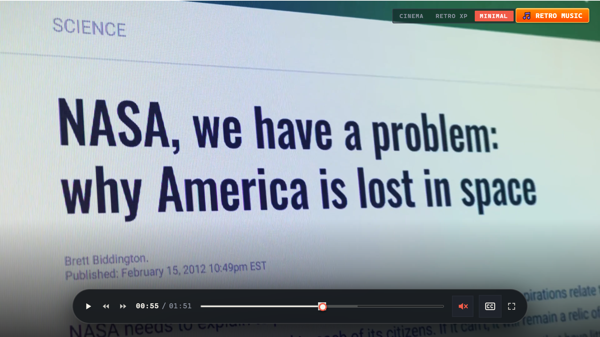

<div align="center">

# FOLD
### The Living Cinema Interface

**One media experience. Three visual identities. A little nostalgia.**

An open-source collection of custom **Video.js v10** player interfaces built with **React, TypeScript, and CSS**, featuring a cinematic folding control deck, an authentic Windows XP-inspired player, and a minimal viewing mode. Includes a separate local music listening suite with real-time audio-reactive visualizations.

<br/>

[](https://fold-videojs.vercel.app/preview)
[](https://sharique-shaikh-git.github.io/fold-videojs/preview.html)
[](https://videojs.org)
[](LICENSE)

<br/>

[Live Player](https://fold-videojs.vercel.app/preview) · [Workbench](https://fold-videojs.vercel.app/) · [Features](#features) · [Preview](#preview) · [Getting Started](#getting-started) · [Architecture](#architecture) · [Accessibility](#accessibility) · [License](#license)

</div>

---

> **Contra × Video.js Skins Design Challenge Entry**  
> FOLD Cinema is the flagship video skin. Retro XP and Minimal are alternate video interfaces; FOLD Music is a dedicated, isolated audio experience. The video demonstration uses official NASA public domain footage served via Mux.

---

## 🌐 Live Production Demos

| Environment | Standalone Player (Clean View) | Interactive Workbench Suite |
| :--- | :--- | :--- |
| 🚀 **Vercel (Production)** | [**fold-videojs.vercel.app/preview**](https://fold-videojs.vercel.app/preview) | [**fold-videojs.vercel.app**](https://fold-videojs.vercel.app/) |
| 📦 **GitHub Pages (Mirror)** | [sharique-shaikh-git.github.io/.../preview.html](https://sharique-shaikh-git.github.io/fold-videojs/preview.html) | [sharique-shaikh-git.github.io/fold-videojs](https://sharique-shaikh-git.github.io/fold-videojs/) |

*Instant, high-performance Video.js v10 streaming via Mux HLS — no login required. Seamless skin switching between Cinema, Retro XP, and Minimal, plus the dedicated FOLD Retro Music visualizer suite.*

---

## Preview

| Cinema (Expanded) | Retro XP (Video) | Minimal |
|:--:|:--:|:--:|
|  |  |  |

<br/>

<div align="center">

### FOLD Retro Music Suite
*Real-time Web Audio API AnalyserNode Frequency Visualizer*


</div>

---

## Features

### 🎬 Cinema — The Signature FOLD Skin
*Inspired by folding field monitors, analog hardware, and film flatbeds.*
- **Two-Stage Folding Deck**: Sleek compact transport bar (48px) for unobtrusive viewing, unfolding into a 4-tier director's command console.
- **Continuous Seek Timeline**: Precision 0%–100% continuous progress bar with calibrated interval tick marks, elapsed fill in signature vermilion, and interactive needle playhead.
- **SMPTE Timecodes**: Drop-frame accurate timecode displays with frame-level resolution (`00:55:14 / 01:51:00`) and click-to-toggle remaining time mode.
- **Creative Playback Tools**:
  - **Frame Capture**: Instant client-side PNG snapshot capture (`fold-frame-*.png`) from active video frames where cross-origin permissions permit.
  - **Range Trimmer (Clip Creator)**: Interactive `In` / `Out` timeline range markers with looping clip preview and EDL cue metadata export.
- **Full Video.js v10 Integration**: Working play/pause, seek, volume, speed matrix (`0.75×` to `2.0×`), captions menu, PiP, and cinema fullscreen.

### 🕹️ Retro XP — Nostalgic Video Interface
*Authentic Windows Media Player 9/XP styling with modern Video.js engine.*
- **Luna Blue & Silver Chrome**: Genuine beveled gradients, window titlebar controls, and metallic brushed console bar.
- **Emerald Green Digital LCD**: Displays real-time playback state (`PLAYING`, `PAUSED`, `STOPPED`) and SMPTE timecodes.
- **Unobstructed Viewport**: Clean video presentation with zero unwanted overlays or ambient soundtracks playing over the video.
- **Shared Precision Seeker**: Utilizes the unified `SharedSeekBar` component for exact seek fidelity at 25%, 50%, and 75%.

### 🪟 Minimal — Pure Media Focus
*Watch without distraction.*
- **Floating Centered Glass Dock**: Unobtrusive frosted dock with essential controls.
- **Full Playback Synchronization**: Seamlessly preserves current time, volume, and playback state when toggling between skins.

### 🎵 FOLD Retro Music Suite — Dedicated Audio Experience
*A separate, isolated music suite inspired by classic desktop media players.*
- **Local Audio Ingestion**: Drag and drop or browse local `MP3`, `WAV`, `FLAC`, `OGG`, or `AAC` files (browser-supported formats).
- **Strict Audio-Video Isolation**:
  - Video and music playback are strictly mutually exclusive.
  - Switching to Music immediately pauses the video and conceals the video element.
  - Zero auto-play on initial load; audio only plays upon explicit user interaction.
- **Empty State Display**: Features a glowing retro vinyl animation and prompt:  
  > *"Your music, your memories. Add a track to begin."*
- **Three Authentic Web Audio API Visualizer Presets**:
  1. **Classic Spectrum**: 28 phosphor frequency bars with Winamp/WMP tri-color gradient (Emerald `#00e640` $\to$ Golden Amber `#ffd600` $\to$ Vermilion `#f05b48`) with gravity peak drop caps and CRT scanlines.
  2. **Oscilloscope**: High-luminance neon green phosphor CRT waveform beam (`#00ff66`) with soft blooming glow.
  3. **Liquid Memory**: Psychedelic generative mandala driven by multi-band FFT spectral energy (bass core pulse, mid harmonic folding, treble starbursts).
  - Visualizers settle to a calm, tranquil baseline when paused or silent; respects `prefers-reduced-motion`.
- **Complete Transport & Playlist Drawer**: Track queue with remove and clear actions, repeat modes (`off`, `all`, `one`), shuffle, stop, seek scrubber, and volume slider.

> **Scope Clarification**: Clip in/out selection exports cue metadata and does not re-encode server-side MP4 files. Frame capture is subject to canvas cross-origin restrictions. Closed captions are provided for genuine synchronized demonstration tracks (English, Spanish, French, Urdu RTL, Arabic RTL).

---

## Design Philosophy

FOLD explores how a media player interface can offer tactile, granular control without cluttering the moving picture. 

```
                                  [FOLD Player Runtime]
                                            │
                    ┌───────────────────────┴───────────────────────┐
                    ▼                                               ▼
         [Video Experience Mode]                         [Music Experience Mode]
      data-fold-experience="video"                    data-fold-experience="music"
                    │                                               │
   ┌────────────────┼────────────────┐              ┌───────────────┼───────────────┐
   ▼                ▼                ▼              ▼               ▼               ▼
 Cinema          Retro XP         Minimal       Dedicated       Local Audio      3 Real-Time
 (Folding)       (WinXP)          (Dock)       HTMLAudioEl      Playlist Mgr     Visualizers
```

### Color Palette

| Token | Hex | Role |
| :--- | :--- | :--- |
| **Graphite** | `#111418` | Deep cinema background & console foundation |
| **Warm Ivory** | `#F5F2EA` | High-contrast editorial typography |
| **Vermilion** | `#F05B48` | Primary accent, tally lights, timeline progress |
| **Phosphor Green** | `#00FF66` | Retro XP LCD text & oscilloscope beam |
| **Luna Blue** | `#0055EA` | Retro titlebar chrome & active highlights |

---

## Built With

- **[Video.js v10](https://videojs.org/)** (`@videojs/core`, `@videojs/react`) — Next-generation media player primitives
- **[React 19](https://react.dev/)** & **[TypeScript](https://www.typescriptlang.org/)**
- **Web Audio API** — Real-time `AnalyserNode` for frequency and time-domain signal processing
- **CSS Custom Properties & Container Queries** — Fluid responsive scaling across desktop, tablet, and mobile
- **[Vite](https://vite.dev/)** — Blazing fast dev server and production bundler
- **[Playwright](https://playwright.dev/)** — Full browser playback, seek, and accessibility verification

---

## Getting Started

### Prerequisites
- Node.js 18+
- [pnpm](https://pnpm.io/) (`corepack enable pnpm` or `npm install -g pnpm`)

### Installation & Run

```bash
# Clone the repository
git clone https://github.com/Sharique-shaikh-git/fold-videojs.git
cd fold-videojs

# Install dependencies
pnpm install

# Start development server
pnpm dev
```

Open `http://localhost:5173/preview.html` in your browser.

### Verification & Testing

```bash
# Run TypeScript compilation check
pnpm run typecheck

# Run Playwright automated verification suite (50 test assertions)
pnpm test

# Run individual test suites
pnpm run test:seeking     # Tests seeking, scrubbing, captions across Cinema, Retro XP, Minimal
pnpm run test:music       # Tests music architecture, zero-autoplay, upload, and visualizers

# Production build
pnpm run build
```

---

## Keyboard Shortcuts

| Key | Action | Context |
| :--- | :--- | :--- |
| `Space` / `k` | Toggle Play / Pause | Video & Music |
| `←` / `→` | Seek backward / forward 10 seconds | Video & Music |
| `↑` / `↓` | Increase / decrease volume 5% | Video & Music |
| `m` | Toggle Mute | Video & Music |
| `f` | Toggle Fullscreen | Video & Music |
| `c` | Cycle Subtitles & Closed Captions | Video |
| `o` / `Esc` | Toggle / Collapse Cinema Folding Deck | Cinema Skin |
| `0`–`9` | Seek to 0%–90% of duration | Video |

---

## Accessibility & Standards

- **WCAG 2.1 AAA Contrast**: Text and control badges maintain $>7:1$ contrast against video scrims and solid console surfaces.
- **Keyboard Navigation**: Every interactive control has visible focus indicators, explicit accessible names (`aria-label`), and handles standard navigation keys.
- **RTL Language Support**: Urdu and Arabic subtitles dynamically configure container text direction (`dir="rtl"`).
- **Reduced Motion**: Respects `prefers-reduced-motion` by reducing animation speeds and disabling rotational transforms.

---

## Video & Audio Sources

- **Video**: NASA Public Domain mission footage streamed via Mux HLS.
- **Demo Audio**: Synthesized 30-second stereo ambient pad (`cosmic-ambience.wav`) generated via programmatic PCM synthesis (`scripts/generate-audio.cjs`). Free of third-party copyright.
- **Captions**: Multi-lingual launch transcripts (English, Spanish, French, Urdu, Arabic).

---

## License

This project is open-source and licensed under the [Apache License, Version 2.0](LICENSE).

```
Copyright 2026 FOLD Authors (Sharique Shaikh)

Licensed under the Apache License, Version 2.0 (the "License");
you may not use this file except in compliance with the License.
You may obtain a copy of the License at

    http://www.apache.org/licenses/LICENSE-2.0
```

---

<div align="center">
  <sub>Designed and developed by <strong>Sharique Shaikh</strong> · Built for the <strong>Video.js Skins Design Challenge</strong></sub>
</div>
