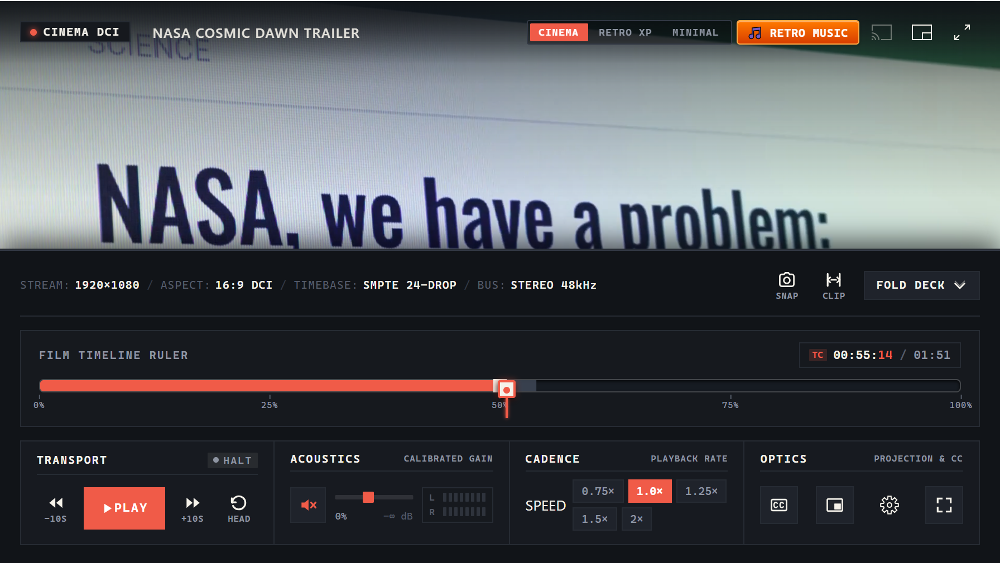
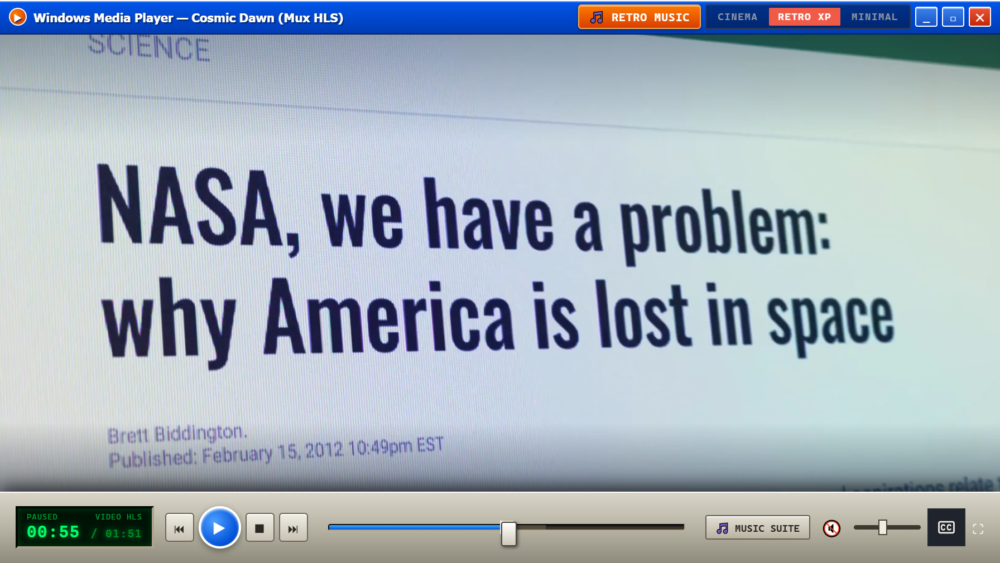
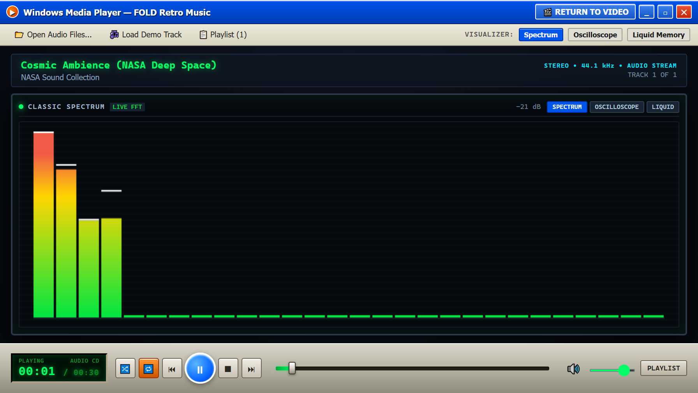

<div align="center">

# FOLD
### The Living Cinema Interface for Video.js v10

**One media runtime. Three distinct visual identities. A touch of nostalgia.**

An open-source collection of custom **Video.js v10** player interfaces built with **React 19, TypeScript, and CSS**, featuring an analog folding director's deck, an authentic Windows XP-inspired player, and a distraction-free minimal viewing mode. Includes an isolated retro music listening suite with real-time Web Audio API visualizers.

<br/>

[](https://fold-videojs.vercel.app/)
[](https://github.com/Sharique-shaikh-git/fold-videojs)
[](https://videojs.org)
[](LICENSE)

<br/>

🚀 **[Launch Live Demo](https://fold-videojs.vercel.app/)** · 🎬 **[Standalone Player View](https://fold-videojs.vercel.app/preview)** · 📦 **[GitHub Repository](https://github.com/Sharique-shaikh-git/fold-videojs)**

[Features](#features) · [Skins Overview](#skins-overview) · [Preview](#preview) · [Architecture](#architecture) · [Getting Started](#getting-started) · [Keyboard Shortcuts](#keyboard-shortcuts) · [Accessibility](#accessibility) · [License](#license)

</div>

---

> **🏆 Contra × Video.js Skins Design Challenge Entry**  
> FOLD was designed and engineered specifically for the official **Video.js v10 Skins Design Challenge**. It showcases how modern Video.js v10 primitives (`@videojs/core`, `@videojs/react`, `@videojs/mux-video`) can power tactile, cinematic interfaces that balance advanced editorial utilities with pure viewing immersion.

---

## 🌐 Live Production Deployments

Experience FOLD directly in your browser with zero sign-in required:

| Service | Experience | Link |
| :--- | :--- | :--- |
| 🚀 **Vercel (Primary)** | **Interactive Workbench Suite** | [**fold-videojs.vercel.app**](https://fold-videojs.vercel.app/) |
| 🚀 **Vercel (Primary)** | **Clean Standalone Player** | [**fold-videojs.vercel.app/preview**](https://fold-videojs.vercel.app/preview) |
| 📦 **GitHub Pages (Mirror)** | **Standalone Player Mirror** | [**sharique-shaikh-git.github.io/fold-videojs/preview.html**](https://sharique-shaikh-git.github.io/fold-videojs/preview.html) |
| 📦 **GitHub Pages (Mirror)** | **Workbench Mirror** | [**sharique-shaikh-git.github.io/fold-videojs/**](https://sharique-shaikh-git.github.io/fold-videojs/) |

*High-performance Mux HLS streaming with instant skin toggling, frame-accurate seeking, and real-time audio visualization.*

---

## Preview

| Cinema (Expanded Console) | Retro XP (Video Mode) | Minimal (Dock) |
|:--:|:--:|:--:|
|  |  |  |

<br/>

<div align="center">

### FOLD Retro Music Suite
*Real-time Web Audio API AnalyserNode Frequency Visualizer with Phosphor Peak Hold*



</div>

---

## Skins Overview

FOLD features three distinct video skins plus an isolated music experience, all operating on a unified Video.js v10 runtime:

### 1. 🎬 Cinema — Flagship Folding Interface
*Inspired by professional field directors' monitors, analog broadcast gear, and Steenbeck flatbed editors.*
- **Two-Stage Folding Deck**: Sleek compact transport bar (48px) for unobtrusive viewing that smoothly unfolds into a 4-tier director's command console.
- **Continuous Seek Timeline**: Precision 0%–100% horizontal progress bar with calibrated interval tick marks, signature vermilion elapsed fill, and interactive needle playhead.
- **SMPTE Timecodes**: Drop-frame accurate timecode displays with frame-level resolution (`00:55:14 / 01:51:00`) and click-to-toggle remaining time mode.
- **Creative Playback Tools**:
  - **Frame Capture**: Instant client-side PNG snapshot capture (`fold-frame-*.png`) directly from active video frames.
  - **Range Trimmer (Clip Creator)**: Interactive `In` and `Out` timeline range markers with looping clip preview and EDL cue metadata export.
- **Full Video.js v10 Integration**: Play/pause, seek, volume popover, speed matrix (`0.75×` to `2.0×`), captions menu, Picture-in-Picture, and cinema fullscreen.

### 2. 🕹️ Retro XP — Nostalgic Media Interface
*Authentic Windows Media Player 9 / Windows XP styling driven by the modern Video.js v10 engine.*
- **Luna Blue & Silver Chrome**: Genuine beveled gradients, metallic brushed console bar, and classic window controls.
- **Emerald Digital LCD**: Phosphor green LCD display with real-time playback state indicator (`PLAYING`, `PAUSED`, `STOPPED`) and SMPTE timecodes.
- **Unobstructed Viewport**: Clean video presentation with zero unwanted audio overlays or synthetic noise.
- **Shared Precision Seeker**: Uses the unified `SharedSeekBar` component for exact seek fidelity at 25%, 50%, and 75% benchmarks.

### 3. 🪟 Minimal — Distraction-Free Media Focus
*Pure video immersion.*
- **Floating Glass Dock**: Frosted backdrop dock with essential transport controls that auto-hides during inactive playback.
- **State Preservation**: Seamlessly retains video position, volume, playback state, and active subtitles when toggling between skins.

### 4. 🎵 FOLD Retro Music Suite — Dedicated Audio Experience
*A separate, isolated music suite inspired by classic desktop audio players.*
- **Local Audio Ingestion**: Drag and drop or browse local `MP3`, `WAV`, `FLAC`, `OGG`, or `AAC` files (browser-supported formats).
- **Strict Audio-Video Isolation**:
  - Video and music playback are strictly mutually exclusive.
  - Switching to Music immediately pauses the video and conceals the video viewport.
  - Zero auto-play on initial load; audio only plays upon explicit user interaction.
- **Empty State Display**: Features a glowing retro vinyl animation and prompt:  
  > *"Your music, your memories. Add a track to begin."*
- **Three Authentic Web Audio API Visualizer Presets**:
  1. **Classic Spectrum**: 28 phosphor frequency bars with Winamp/WMP tri-color gradient (Emerald `#00e640` $\to$ Golden Amber `#ffd600` $\to$ Vermilion `#f05b48`), gravity peak drop caps, and CRT scanlines.
  2. **Oscilloscope**: High-luminance neon green phosphor CRT waveform beam (`#00ff66`) with soft blooming glow.
  3. **Liquid Memory**: Psychedelic generative mandala driven by multi-band FFT spectral energy (bass pulse, mid harmonics, treble starbursts).
  - Visualizers settle to a tranquil baseline when paused or silent; fully respects `prefers-reduced-motion`.
- **Complete Transport & Playlist Drawer**: Track queue with remove and clear actions, repeat modes (`off`, `all`, `one`), shuffle, stop, seek scrubber, and volume slider.

---

## 🌍 Multilingual Captions & Accessibility

- **5 Synchronized Subtitle Tracks**: English, Spanish, French, Urdu (اردو), and Arabic (العربية).
- **Native RTL Rendering**: Urdu and Arabic subtitles dynamically configure container text direction (`dir="rtl"`) with proper Arabic script font fallbacks.
- **Strict Single-Track Discipline**: Only one subtitle track can be active at any time; selecting "Off" hides all overlays with zero duplicate text rendering.
- **WCAG 2.1 AAA Contrast**: Text and control badges maintain $>7:1$ contrast against video scrims and solid console surfaces.
- **Keyboard Navigation**: Full keyboard navigation across all controls, focus rings, standard shortcuts, and Escape dismissal.
- **Mobile Responsive**: Tested and optimized across 320px, 375px, 430px, 768px, and desktop viewports.

---

## 🛠️ Architecture & Technology Stack

```
                                  [FOLD Player Runtime]
                                            │
                    ┌───────────────────────┴───────────────────────┐
                    ▼                                               ▼
         [Video Experience Mode]                         [Music Experience Mode]
       data-fold-experience="video"                    data-fold-experience="music"
                    │                                               │
    ┌────────────────┼────────────────┐              ┌───────────────┼───────────────┐
    ▼                ▼                ▼              ▼               ▼               ▼
  Cinema          Retro XP         Minimal       Dedicated       Local Audio      3 Real-Time
  (Folding)       (WinXP)          (Dock)       HTMLAudioEl      Playlist Mgr     Visualizers
```

- **[Video.js v10](https://videojs.org/)** (`@videojs/core`, `@videojs/react`, `@videojs/mux-video`) — Next-generation media player primitives and Mux streaming
- **[React 19](https://react.dev/)** & **[TypeScript](https://www.typescriptlang.org/)** — Robust component architecture and strict type safety
- **Web Audio API** — Real-time `AnalyserNode` for frequency (FFT) and time-domain signal processing
- **Tailwind CSS v4 & CSS Container Queries** — Fluid responsive scaling across desktop, tablet, and mobile
- **[Vite 8](https://vite.dev/)** — Blazing fast dev server and production bundler
- **[Playwright](https://playwright.dev/)** — Full browser playback, seek, and accessibility verification suite

---

## 🚀 Getting Started

### Prerequisites
- Node.js 18+
- [pnpm](https://pnpm.io/) (`corepack enable pnpm` or `npm install -g pnpm`)

### Installation & Run

```bash
# Clone the repository
git clone https://github.com/Sharique-shaikh-git/fold-videojs.git
cd fold-videojs

# Install dependencies
pnpm install

# Start development server
pnpm dev
```

Open `http://localhost:5173/preview.html` in your browser.

### Verification & Testing

```bash
# Run TypeScript compilation check
pnpm run typecheck

# Run automated verification suite
pnpm test

# Run individual test suites
pnpm run test:seeking     # Tests seeking, scrubbing, captions across Cinema, Retro XP, Minimal
pnpm run test:music       # Tests music architecture, zero-autoplay, upload, and visualizers

# Production build
pnpm run build
```

---

## ⌨️ Keyboard Shortcuts

| Key | Action | Context |
| :--- | :--- | :--- |
| `Space` / `k` | Toggle Play / Pause | Video & Music |
| `←` / `→` | Seek backward / forward 10 seconds | Video & Music |
| `↑` / `↓` | Increase / decrease volume 5% | Video & Music |
| `m` | Toggle Mute | Video & Music |
| `f` | Toggle Fullscreen | Video & Music |
| `c` | Cycle Subtitles & Closed Captions | Video |
| `o` / `Esc` | Toggle / Collapse Cinema Folding Deck | Cinema Skin |
| `0`–`9` | Seek to 0%–90% of duration | Video |

---

## 📄 License & Attribution

This project is open-source and licensed under the [Apache License, Version 2.0](LICENSE).

```
Copyright 2026 FOLD Authors (Sharique Shaikh)

Licensed under the Apache License, Version 2.0 (the "License");
you may not use this file except in compliance with the License.
You may obtain a copy of the License at

    http://www.apache.org/licenses/LICENSE-2.0
```

- **Video Stream**: NASA Public Domain mission footage streamed via Mux HLS.
- **Demo Audio**: Synthesized 30-second ambient pad (`cosmic-ambience.wav`) generated via programmatic PCM synthesis (`scripts/generate-audio.cjs`), completely free of third-party copyright.
- **Captions**: Multi-lingual launch transcripts (English, Spanish, French, Urdu, Arabic).

---

<div align="center">
  <sub>Designed and developed by <strong>Sharique Shaikh</strong> · Built for the <strong>Video.js Skins Design Challenge</strong></sub>
</div>
